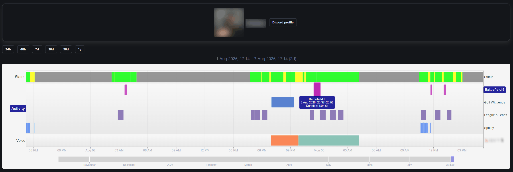

# online-activity-tracker

Steam and Discord scraper collecting ephemeral activity data

[**Viewer Live Demo**](https://oat-demo.muflon.cc/discord-users/12) ([Anonymized data](#demo-data), not updated live)



The app collects the following data:

1. Steam User's Persona State (Online, AFK, Busy etc.)
2. Steam User's Active App (which app/game the user is in)
3. Steam User's extra info (name, avatar)
4. Steam App's extra info (name, image)
5. Discord User's Status (Online, AFK, Busy etc.)
6. Discord User's Activities (In Game X, Listening to Y)
7. Discord User's Voice Channel activity (joining/leaving Voice Channels)
8. Discord User's extra info (name, avatar)
9. Discord Guild's extra info (name, icon)
10. Discord Channel's extra info (name)

Data is saved to a [SQLite](https://sqlite.org/) database operating in WAL mode ([can easily backup live](https://litestream.io/)).

## Running

1. Configure secrets in `oat.toml`:

```toml
# Required for Steam tracking to work
[steam]
key = "abc"

# Required for Discord tracking to work
[discord]
token = "a.b.c"
```

2. Run DB migrations

```bash
oat manage db migrate
```

3. Configure tracked users

```bash
# You can run these while tracking is in progress!

# Add Steam user by SteamID64
oat manage steam enable 123

# Add Discord user by their ID + Guild ID via which status+activities data should be collected
oat manage discord enable 123 321

# Disable users - this will only stop tracking, it will not delete existing data
oat manage steam disable 123
oat manage discord disable 123
```

4. Run services

```bash
# steam - steam tracking
# discord - discord tracking
# viewer - HTTP server for basic data analysis

# Run as seperate processes
oat run steam
oat run discord

# Or in a single process
oat run steam discord viewer
```

## Build

Warning: very difficult

```bash
go build -o oat .
```

## Docker

The working directory is the `/data` mount.

1. Create a `./data` directory and put your `oat.toml` inside it. Ensure uid `65532`, has read/write access to it:

```bash
mkdir -p data
sudo chown -R 65532:65532 data
```

2. Build the image:

```bash
docker build -t oat .
```

3. Follow configuration steps 2-3 in [Running](#running), replacing `oat` with `docker run --rm -v ./data:/data oat`

4. Start the container (long-lived):

```bash
docker run -d --name oat \
  -p 8080:8080 \
  -v ./data:/data \
  --restart unless-stopped \
  oat run steam discord viewer
```

_(port mapping is not required if not using `viewer` service)_

## All config options

```toml
[logs]
debug = false                # enable debug log level
format = "json"              # log format used by "run": json | text | simpletext
manage_format = "simpletext" # log format used by "manage"

[database]
path = "./oat.db"

[steam]
key = ""
poll_interval = "2m"
app_extra_info_stale_check_interval = "1m"
app_extra_info_stale_time = "72h"

[discord]
token = ""

[viewer]
listen_addr = ":8080"
```

## Demo data

[`scripts/anonymize.sql`](/scripts/anonymize.sql) scrambles identifiable info like usernames or discord activity data so it is safe to publish publicly.

```bash
# 1. create a copy (can also use "oat manage db vacuum ./anon.db")
sqlite3 data/oat.db ".backup anon.db"

# 2. anonymize the copy
sqlite3 -bail anon.db < scripts/anonymize.sql
```
